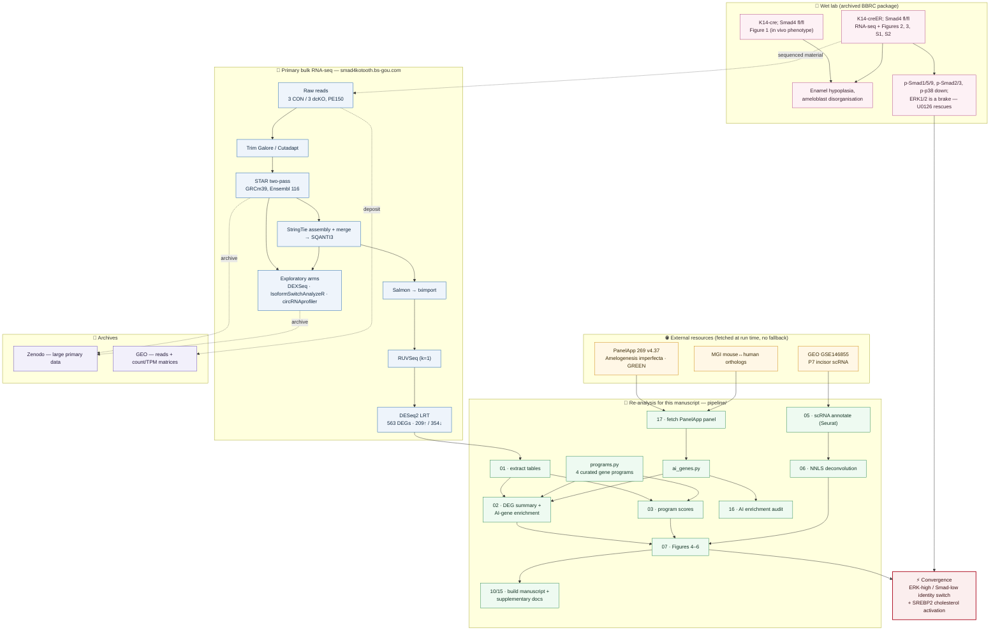

# GSE341665

**Epithelial *Smad4* loss reprograms ameloblast identity and metabolism**

Reproducible code and processed data for a mouse genetic + transcriptomic study of how
epithelial *Smad4* deletion disrupts enamel formation. Deleting *Smad4* in dental
epithelium collapses the ameloblast secretory/identity programme (enriched for human
amelogenesis-imperfecta genes), switches the cell to a wound/stress state, and activates
the **SREBP2 cholesterol-biosynthesis** programme — a cell-intrinsic identity switch, not
a change in tissue composition.


-success)

> **Repository name.** This repository is named for the GEO accession `GSE341665`.
> Large primary data live on **Zenodo** (data DOI `10.5281/zenodo.21637766`); the interactive
> primary-analysis report is at
> <http://smad4kotooth.bs-gou.com/>.

---

## Workflow at a glance



---

## Repository layout

```
GSE341665/
├── README.md                 ← you are here
├── LICENSE                   ← MIT (code); data are CC-BY-4.0
├── CITATION.cff              ← how to cite
├── ENVIRONMENT.md            ← software + versions
├── pipeline/                 ← all analysis code (run in numbered order)
│   ├── programs.py           ·  single definition of the 4 gene programs
│   ├── ai_genes.py           ·  AI panel loader (imports the versioned CSV)
│   ├── ai_gene_provenance.py ·  verified MIM/PMID provenance (Supp. Tables S1–S2)
│   ├── 01_… 17_…             ·  extract → DEG → programs → scRNA → deconv → figures → docs
│   └── SUPPLEMENTARY_METHODS.md
├── data/                     ← LARGE primary data — not in Git; see each FILELIST.md
│   ├── 00_raw_reads/         ·  FASTQ                        (Zenodo / GEO)
│   ├── 01_star_bam/          ·  STAR two-pass BAM            (Zenodo)
│   ├── 02_denovo_assembly/   ·  StringTie/SQANTI3 GTF        (Zenodo)
│   ├── 03_salmon_quant/      ·  Salmon quant, counts/TPM     (Zenodo)
│   ├── 04_deseq2_ruvseq/     ·  RUVSeq/DESeq2 objects        (Zenodo)
│   ├── 05_scref_GSE146855/   ·  single-cell reference        (public GEO)
│   └── 06_exploratory/       ·  circRNA / AS / DEU results   (Zenodo + website)
├── reference/                ← genome + annotation — not in Git (FILELIST.md)
└── results/
    ├── figures/              ·  computational Figures 4–6, S3, S4 (PNG)
    └── supplementary_data/   ·  Supplementary Data S1–S5, AI panel, enrichment sensitivity,
                              ·  and Tables S1–S2 (verified OMIM/PMID provenance)
```

Each `data/` and `reference/` folder is **intentionally empty except for a `FILELIST.md`**
that names the expected files, their sizes, and where to download them. This keeps the
folder structure under version control while the multi-gigabyte primary data live on Zenodo.

---

## Reproduce the analysis

```bash
# 1. clone
git clone https://github.com/LabOnoM/GSE341665.git && cd GSE341665

# 2. fetch large data from Zenodo into the matching data/ and reference/ folders
#    (see each FILELIST.md; DOI on release)

# 3. run the pipeline from the repository root, in order
python3 pipeline/01_extract_tables.py
python3 pipeline/02_deg_analysis.py          # 563 DEGs; AI-gene enrichment
python3 pipeline/03_module_scores.py
bash    pipeline/04_download_scref.sh         # public GSE146855
Rscript pipeline/05_scref_annotate.R
python3 pipeline/06_deconvolution.py
python3 pipeline/17_fetch_ai_panel.py         # PanelApp 269 v4.37 (pinned) + MGI orthologs
python3 pipeline/16_ai_gene_enrichment.py     # corrected enrichment + defect audit
python3 pipeline/07_figures.py                # Figures 4–6
```

The pipeline is **deterministic** (fixed seeds); `05_scref_annotate.R` is the only stochastic
step (`set.seed(1)`). External resources (PanelApp, MGI, GSE146855) are fetched at run time and
the code **fails loudly** rather than substituting a stored fallback. See `ENVIRONMENT.md`.

---

## Key result

| | Value |
|---|---|
| DEGs (padj < 0.05, \|log2FC\| > 1) | **563** (209 up / 354 down) of 15,803 tested |
| Human AI-gene enrichment (down vs up) | **OR 9.21, P = 1.7 × 10⁻⁴** (PanelApp 269 v4.37, 31 GREEN genes; 18 of 20 significant panel genes are down-regulated) |
| Ameloblast fraction (deconvolution) | preserved/increased (maturation 57 → 61%, *P* = 0.006) → switch is cell-intrinsic |
| Sterol (SREBP2) programme | coordinately up; ERK-driven, Smad-de-repressed |

The amelogenesis-imperfecta gene panel is taken from **Genomics England PanelApp** (panel 269,
version 4.37, GREEN genes only) so the gene set is versioned and reproducible; each gene's OMIM
phenotype MIM and primary reference are verified in `pipeline/ai_gene_provenance.py` and
Supplementary Tables S1–S2.

---

## Data-integrity notes

This repository records defects found during pre-submission auditing and how they were
resolved, because the fixes constrain how the code must be used.

**Read `DEG_table.csv` with `float_precision="round_trip"`.** Very small adjusted *P*
values are stored in full decimal notation (*Amelx* has 91 leading zeros) and pandas'
default float parser silently flushes them to `0.0`. This made 420 genes look like
underflow when only **5** genuinely are, and fabricated the −log10 *P* distribution that
an earlier version of Figure 4B was designed around. DEG counts and the enrichment were
**unaffected** — every threshold is `padj < 0.05`, and 0 < 0.05 — so the corruption was
confined to displays and exported values.

**The AI-gene panel is external and version-pinned.** Its hand-curated predecessor had a
largely fabricated provenance column (18 of 20 PMIDs cited unrelated papers). It is
replaced by Genomics England PanelApp panel 269 v4.37, retrieved by
`pipeline/17_fetch_ai_panel.py`, which fails loudly rather than falling back to a stored
copy. Every OMIM phenotype MIM and primary PMID for all 31 genes was verified against
NCBI; see `results/supplementary_data/AI_gene_provenance_TableS1_S2.md`.

**Program scores are effect sizes, not *t* tests.** Each gene is *z*-scored across the
same six samples before averaging, which collapses within-group variance; a parametric
*t* test on the result returns *P* values that measure the scoring arithmetic rather than
biological replication. With n = 3 vs 3 the exact permutation floor is **P = 0.10**, and
all four programs attain it.

**Genotypes differ by experiment.** The sequenced material is
*K14-creER;Smad4^fl/fl^* (tamoxifen-inducible); the in vivo enamel phenotype in Figure 1
uses the constitutive *K14-cre* line.

---

## Data availability

- **Sequencing data & processed matrices** — NCBI GEO [`GSE341665`](https://www.ncbi.nlm.nih.gov/geo/query/acc.cgi?acc=GSE341665).
- **Large intermediate data** (BAM, GTF, quantification, exploratory-arm outputs) — Zenodo
  [`10.5281/zenodo.21637766`](https://doi.org/10.5281/zenodo.21637766).
- **Interactive primary-analysis report** (including the exploratory circRNA / alternative-
  splicing / DEU arms not interpreted in the manuscript) — <http://smad4kotooth.bs-gou.com/>.
- **Single-cell reference** — GEO GSE146855 (Chiba et al. 2020), public.

## Questions, feedback and reuse

- **Discussions** — questions about the biology or the analysis, and ideas for extensions
- **Issues** — bugs, numbers that do not reproduce, and data-access requests (templates provided)
- **[`docs/`](docs/)** — data-access map, known issues and caveats, FAQ

Please read [`docs/known-issues.md`](docs/known-issues.md) before running the pipeline or
interpreting the tables; it lists the caveats that change how the outputs should be read.
See [`CONTRIBUTING.md`](CONTRIBUTING.md) for what to post where.

## Citation

See `CITATION.cff`. Please cite the manuscript and the Zenodo archive.

## License

Code: MIT (`LICENSE`). Processed data and figures: CC-BY-4.0. Please attribute.
