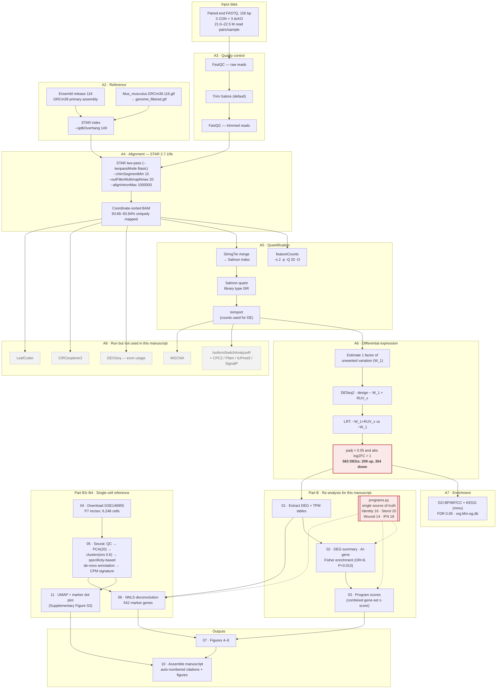

# Supplementary Methods — Complete Bioinformatics Pipeline

*Epithelial Smad4 loss reprograms ameloblast identity and metabolism*

This document records the exact workflow, parameters, and software versions for all
computational analyses, in two parts: **Part A**, the primary bulk RNA-sequencing
pipeline (as executed and recorded in the analysis logs); and **Part B**, the
re-analysis performed for this manuscript (gene-program scoring and cell-type
deconvolution). Values are transcribed from the pipeline's own logs and saved
parameter objects; where a parameter was not recorded, this is stated explicitly
rather than inferred.

---

## Part A — Primary bulk RNA-sequencing pipeline

### A1. Experimental design

| Field | Value |
|---|---|
| Samples | 6: CON1, CON2, CON3 (control) and dcKO1, dcKO2, dcKO3 (Smad4 conditional knockout) |
| Genotype | dcKO: **K14-cre; Smad4^fl/fl^** (constitutive epithelial deletion). CON: Cre-negative Smad4^fl/fl^ littermates. The tamoxifen-inducible K14-creER line was used for other experiments in the study but **not** for the sequenced material. |
| Groups | 2 groups × 3 biological replicates |
| Tissue | Dental epithelium (mandibular molar tooth germ) |
| Layout | Paired-end, 150 bp |
| Library strandedness | Reverse-stranded; automatically detected by Salmon as **ISR**, and used as `-s 2` in featureCounts |
| Contrast | dcKO vs CON |

### A2. Reference genome and annotation

| Field | Value |
|---|---|
| Assembly | *Mus musculus* GRCm39, `Mus_musculus.GRCm39.dna.primary_assembly.fa` |
| Annotation | `Mus_musculus.GRCm39.116.gtf` |
| Source | Ensembl **release 116** (`ftp://ftp.ensembl.org/pub/release-116/`) |
| Annotation database | `org.Mm.eg.db`; biomaRt dataset `mmusculus_gene_ensembl`; KEGG organism `mmu`; UniProt taxon `10090` |

The GTF was filtered before index building (`genome_filtered.gtf`); genes lacking a
`gene_name` attribute retained their `gene_id`.

### A3. Read quality control and trimming

- **FastQC** on raw reads, on trimmed reads, and on aligned BAM files.
- **Trim Galore v0.6.10** (wrapping **cutadapt v4.9**) with default settings: quality
  Phred cutoff 20, ASCII+33 encoding, automatic adapter detection.

**Disclosed inconsistency.** Adapter detection is performed per sample, and the
auto-detected adapter was **not identical across samples**: CON1 was trimmed using the
Illumina small-RNA adapter (`TGGAATTCTCGG`), whereas CON2, CON3 and all dcKO samples
were trimmed using the Nextera transposase sequence (`CTGTCTCTTATA`). The detection
counts were very low and near-tied for CON1 (8 versus 6 for the runner-up), indicating
negligible adapter contamination in that library, so the practical effect is expected
to be minimal; we report it for completeness.

### A4. Alignment (STAR)

**STAR version 2.7.10b.**

Index construction:
```
STAR --runThreadN 32 --runMode genomeGenerate \
     --genomeDir ./GenomeIndex_ENSEMBL_STAR_ReadLength149/ \
     --genomeFastaFiles genome.fa --sjdbGTFfile genome_filtered.gtf \
     --sjdbOverhang 149 --limitGenomeGenerateRAM 101781612134
```

Alignment (per sample; two-pass):
```
STAR --runMode alignReads --chimSegmentMin 10 \
     --genomeDir ./GenomeIndex_ENSEMBL_STAR_ReadLength149 \
     --readFilesIn <sample>_Clean_Data1_val_1.fq.gz <sample>_Clean_Data2_val_2.fq.gz \
     --outFileNamePrefix ./<sample>.STAR. --alignEndsType Local \
     --outSAMtype BAM SortedByCoordinate --outFilterMultimapNmax 20 \
     --outFilterMismatchNmax 999 --outFilterMismatchNoverLmax 0.04 \
     --alignIntronMin 70 --alignIntronMax 1000000 --alignMatesGapMax 1000000 \
     --alignSJoverhangMin 8 --alignSJDBoverhangMin 1 \
     --outSAMstrandField intronMotif --outFilterType BySJout \
     --twopassMode Basic --outSAMmapqUnique 60 \
     --limitGenomeGenerateRAM 101781612134 --runThreadN 32 --readFilesCommand zcat
```

**Mapping statistics (from `*.STAR.Log.final.out`):**

| Sample | Input read pairs | Uniquely mapped | Uniquely mapped % | Multi-mapped % | Chimeric % |
|---|---|---|---|---|---|
| CON1 | 21,303,455 | 19,975,969 | 93.77 | 3.85 | 0.30 |
| CON2 | 21,235,660 | 19,900,363 | 93.71 | 3.80 | 0.29 |
| CON3 | 20,986,103 | 19,694,042 | 93.84 | 3.81 | 0.28 |
| dcKO1 | 22,453,825 | 21,044,062 | 93.72 | 3.79 | 0.30 |
| dcKO2 | 21,439,266 | 20,080,247 | 93.66 | 3.74 | 0.31 |
| dcKO3 | 22,455,897 | 21,031,771 | 93.66 | 3.77 | 0.28 |

Mapping was uniform across samples (uniquely mapped 93.66–93.84%), with no
genotype-associated difference in alignment quality.

### A5. Quantification

Two quantifications were produced:

1. **featureCounts** (gene-level counts from the STAR BAMs):
   `featureCounts -T 32 -s 2 -p -Q 20 -O -a ./genome_filtered.gtf -o <sample>.STAR.counts`
   (`-s 2` reverse-stranded; `-p` paired-end; `-Q 20` minimum mapping quality; `-O`
   assign reads overlapping multiple features.)
2. **Salmon v1.10.0** selective alignment (`--libType A`, auto-detected as **ISR** in
   every sample) against an index built from a **StringTie**-merged
   transcriptome (a de-novo assembly merged with the reference annotation); library
   type auto-detected as **ISR**.

**The differential-expression analysis used the Salmon quantifications imported with
tximport** (pipeline parameter `CountsFrom = "Tximport"`). Transcripts per million
(TPM) reported in this study derive from that import.

### A6. Differential expression (DESeq2 with RUV correction)

This is the step most often mis-stated; the parameters below are transcribed from the
saved `DESeqDataSet` and the pipeline parameter object.

| Field | Value |
|---|---|
| Package | DESeq2 |
| Counts | Salmon → tximport |
| Unwanted-variation correction | **RUVSeq**, one factor (k = 1), stored as covariate `W_1`. *The specific RUVSeq function (RUVg/RUVs/RUVr) and the control-gene set are not recorded in the pipeline outputs; k = 1 is recoverable from the single `W_1` column.* |
| Design formula | `~ W_1 + RUV_x` (where `RUV_x` is genotype: CON, dcKO) |
| Test | **Likelihood-ratio test (LRT)**, full `~ W_1 + RUV_x` vs reduced `~ W_1` (`Par_Test = "LRT"`) |
| Contrast | `RUV_x`, dcKO vs CON |
| Expression filter | Genes with at least **10 reads in at least 3 samples** (`Par_ReN = 10`, `Par_SaN = 3`) |
| Genes tested | 15,803 |
| Significance | `padj < 0.05` (Benjamini–Hochberg) **and** `|log2 fold change| > 1` (`Par_FDR = 0.05`, `Par_LFC = 1`, `Par_PorFRR = "padj"`) |
| Log2 fold-change shrinkage | Not applied (fold changes are maximum-likelihood estimates) |
| Independent filtering | Enabled; **613 genes (3.9%) have `padj = NA`** and are treated as non-significant |
| Result | **563 differentially expressed genes: 209 up-regulated, 354 down-regulated** |

Because the LRT compares the full and reduced models, the reported *P* values test the
overall genotype effect after adjusting for `W_1`; the accompanying log2 fold changes
are the maximum-likelihood estimates for `RUV_x dcKO vs CON`.

### A7. Functional enrichment

- Over-representation analysis (ORA) and GSEA against **GO** (biological process,
  molecular function, cellular component) and **KEGG** (organism `mmu`), using the
  `org.Mm.eg.db` annotation package in R.
- **Significance was assessed on the raw *P* value, not the false-discovery rate.** The
  report states that enriched GO and KEGG terms, in both GSEA and ORA, "were defined as
  P-value < 0.05", and the pipeline parameter `Par_UseFDR4FEA = FALSE` confirms that FDR
  filtering was disabled. Enrichment results are therefore **not multiplicity-corrected**
  and are used in this manuscript only as qualitative corroboration of programs that were
  independently identified from the ranked differential-expression results; no enrichment
  statistic is reported as a finding.
- The enrichment software is **not named** anywhere in the pipeline outputs.
  **[[Authors: confirm the enrichment package and version before submission.]]**
- Sample clustering/heatmaps used Pearson distance with **ward.D2** linkage
  (`Par_dist = "pearson"`, `Par_hclust = "ward.D2"`).

### A8. Additional analyses performed by the primary pipeline

These were run but are **not used in the present manuscript**; they are listed for
completeness and transparency.

| Analysis | Tool (version) | Outcome — stated accurately |
|---|---|---|
| Differential exon usage | DEXSeq v1.48.0 | 700 significant exon bins across 331 genes at FDR < 0.1 — **but tested on a restricted subset of 987 genes, not transcriptome-wide**. Not used. |
| Isoform switching | IsoformSwitchAnalyzeR v2.2.0 with CPC2, Pfam, SignalP 6.0, IUPred3 | 1,288 isoform switches in 1,098 genes; **no alternative-splicing type and no functional consequence reached enrichment significance**. Not used. |
| Intron excision | LeafCutter | **Only intron clustering was run; no differential intron-excision test was performed.** LeafCutter must not be cited as a completed differential analysis. |
| Circular RNA | CIRCexplorer2 v2.3.8 + circRNAprofiler | 184 circRNAs detected from 210 back-spliced junctions; **0 differentially expressed**. The RBP-motif module failed (the ATtRACT motif database could not be downloaded) and produced no output. Not used. |
| Co-expression networks | WGCNA | 27 modules. **The soft-thresholding power actually selected, the network type, and the TOM type are not recorded**, so the network cannot be reproduced exactly. With n = 6 and a binary trait, module–trait correlations are point-biserial coefficients on six points and are not interpretable as discoveries. Not used. |

**Statement on excluded analyses.** None of the analyses in the table above is used in
the main text, and each is excluded for a stated reason: the circular-RNA arm returned
no differentially expressed circRNAs; the isoform-switching arm returned switches but no
enriched splicing type or functional consequence; the exon-usage arm was run on a
restricted gene subset; LeafCutter differential testing was never executed; and the
WGCNA network cannot be reproduced because its key parameters were not recorded and is
in any case underpowered at n = 6. An earlier draft of this project additionally
explored a KMT2D/ENCODE epigenetic model; that analysis was discarded because *Kmt2d* is
not differentially expressed in these data (log2 fold change −0.08, adjusted *P* = 0.36).

### A9. Parameters that could not be recovered

For transparency, the following were **not recorded** anywhere in the pipeline outputs
and are therefore not stated in this manuscript. They would be required for a bit-exact
reproduction of the primary pipeline:

- The RUVSeq function used (RUVg, RUVs or RUVr) and its control-gene set.
- The WGCNA soft-thresholding power selected, network type, TOM type and correlation type.
- GSEA parameters (ranking metric, permutation number, minimum and maximum gene-set size)
  and the ORA background/universe set.
- The DEXSeq design formula, in particular whether the RUV covariate was carried into the
  exon-usage model.
- The sequencing library-preparation kit.

A further inconsistency is noted: the gene-level DESeq2 model and the isoform-level
analysis each adjusted for a single latent factor, but these were **different vectors**
(they differ in sign for one sample), so the two analyses did not correct for the same
unwanted variation. This does not affect the gene-level results reported here, which are
the only ones used.

---

## Part B — Re-analysis performed for this manuscript

All code is provided in `scripts/JDR_reanalysis/` and is deterministic (fixed seeds).

### B1. Software versions

| Component | Version |
|---|---|
| Python | 3.10.20 |
| numpy / pandas / scipy / matplotlib | 1.26.4 / 2.3.3 / 1.13.1 / 3.10.9 |
| R | 4.3.2 |
| Seurat / SeuratObject | 5.3.1 / 5.2.0 |
| Matrix / uwot / ggplot2 / patchwork | 1.6.5 / 0.2.3 / 4.0.0 / 1.3.2 |
| Pandoc (document assembly) | 2.9.2.1 |
| Operating system | Ubuntu 22.04.5 LTS (Linux 6.8.0) |

### B2. Gene-program scoring

The four curated programs (membership and citations in the main Methods) are defined
once in `scripts/JDR_reanalysis/programs.py` and imported by every analysis and figure
script, so that scoring and display always use identical gene sets.

**Two membership decisions are recorded explicitly.** (i) *Krt76* is among the most
strongly reduced transcripts in the mutant epithelium (log2 fold change −4.64) but was
**excluded** from the ameloblast-identity program: no published work characterises Krt76
in ameloblasts, and the paper most often associated with hair keratins in enamel concerns
*KRT75*, not *KRT76*. It is therefore reported in the main text as an observation rather
than as a literature-defined program member. (ii) *Mmp12* is retained in the wound/stress
program because it behaves with the rest of that program, but it is classically a
macrophage metalloelastase and may be contributed in part by non-epithelial cells; this
caveat is stated in the main text.

For each sample, a **program score** was computed as the mean of gene-wise *z*-scores
of log2(TPM + 1) across program members — the combined gene-set *z*-score of Lee et al.
(2008). Genotypes were compared by two-tailed *t* test.

| Program | *n* genes | CON | dcKO | *P* |
|---|---|---|---|---|
| Ameloblast identity | 16 | +0.90 | −0.90 | 1.6 × 10⁻⁶ |
| Sterol biosynthesis | 20 | −0.91 | +0.91 | 6.9 × 10⁻⁸ |
| Wound / stress | 14 | −0.91 | +0.91 | 3.1 × 10⁻⁷ |
| Interferon-stimulated | 18 | +0.88 | −0.88 | 1.1 × 10⁻⁵ |

### B3. Single-cell reference and annotation

| Field | Value |
|---|---|
| Dataset | Gene Expression Omnibus **GSE146855** (Chiba et al. 2020), postnatal day 7 mouse incisor, 10x Genomics |
| Cells after quality control | 6,248 (of 6,260 deposited) |
| QC filters | `nFeature_RNA` > 200 and < 7,000; mitochondrial content < 25%; genes detected in ≥ 3 cells |
| Normalisation | `NormalizeData` (log-normalisation, scale factor 10,000) |
| Variable features | 2,000 (`FindVariableFeatures`, vst) |
| Dimensionality reduction | `RunPCA`, 30 components computed; **20 PCs** used downstream |
| Clustering | `FindNeighbors(dims = 1:20)`, `FindClusters(resolution = 0.6)` → 17 clusters |
| Embedding | `RunUMAP(dims = 1:20)` (uwot, cosine metric) |
| Seed | `set.seed(1)` |

**Annotation strategy (important).** Enamel-matrix transcripts (*Amelx*, *Ambn*,
*Enam*) are so abundant in this tissue that they appear as ambient RNA in every
droplet — visible in Supplementary Figure S3B as low-level detection across all cell
types. Assigning clusters by absolute marker expression would therefore label every
cluster an ameloblast. Each cluster was instead assigned to the cell type whose
canonical marker set showed the highest **cross-cluster specificity**, computed as the
mean *z*-score of marker expression across clusters.

Marker sets used: secretory ameloblast (*Amelx, Ambn, Enam, Mmp20*); maturation
ameloblast (*Klk4, Odam, Amtn, Slc24a4*); other dental epithelium (*Shh, Sfrp5, Krt14,
Krt5, Epcam, Thbd, Gjb3, Cldn10*); mesenchyme (*Col1a1, Dcn, Lum, Prrx1, Pdgfra, Msx1,
Sp7, Dspp*); immune (*Ptprc, Lyz2, C1qa, Cd68, Fcer1g*); endothelial (*Pecam1, Cdh5,
Egfl7, Emcn*); erythroid (*Hba-a1, Hbb-bs, Hba-a2*).

**Resulting reference composition** (Supplementary Figure S3):

| Cell type | Cells | % |
|---|---|---|
| Mesenchyme | 2,527 | 40.4 |
| Epithelial (inner enamel epithelium / stratum intermedium) | 1,361 | 21.8 |
| Ameloblast, maturation-stage | 1,346 | 21.5 |
| Ameloblast, secretory-stage | 506 | 8.1 |
| Endothelial | 290 | 4.6 |
| Immune | 131 | 2.1 |
| Erythroid | 87 | 1.4 |

### B4. Cell-type deconvolution

| Field | Value |
|---|---|
| Reference signature | Pseudobulk counts per annotated cell type, converted to counts per million |
| Marker panel | Genes with reference expression > 20 CPM in a cell type **and** > 2-fold above the cross-cell-type mean; up to 120 per cell type; union retained and intersected with the bulk matrix (**542 genes**) |
| Method | Non-negative least squares (`scipy.optimize.nnls`; Lawson–Hanson), solved independently per bulk sample |
| Normalisation | Coefficients scaled to sum to 1 per sample |
| Comparison | Two-tailed *t* test, CON vs dcKO |
| Program localisation | Cell-type specificity of each program = mean across-cell-type *z*-score of reference expression of its member genes |

**Result:** ameloblast maturation-stage 56.9% → 61.3% (*P* = 0.006); secretory-stage
33.7% → 35.1% (*P* = 0.084); mesenchyme 9.4% → 3.6% (*P* = 0.002); other populations
below the detection limit of the fit in this dissected-epithelium material.

**Limitations, stated explicitly.** (i) The reference is postnatal-day-7 **incisor**
whereas the bulk material is molar-stage, so proportions are relative rather than
absolute; the CON-versus-dcKO contrast is the robust readout. (ii) Bulk values are TPM
and reference values are CPM, an acknowledged unit mismatch. (iii) The reference was
annotated de novo rather than using author labels, which are not distributed with the
GEO submission. (iv) A stage-matched molar atlas (for example GSE146123) would refine
the immune and endothelial estimates, on which the interferon interpretation depends.

### B5. Reproducibility

The complete chain regenerates from raw inputs. After an unrelated hardware failure
destroyed the intermediate files, the reference was re-downloaded and re-annotated from
scratch and the deconvolution reproduced identically (56.9% → 61.3%, *P* = 0.006;
9.4% → 3.6%, *P* = 0.002).

---

## Part C — Workflow diagram



---

## Supplementary Figure S3

**Supplementary Figure S3. The single-cell reference used for deconvolution.**
**(A)** UMAP embedding of 6,248 quality-controlled cells from GSE146855 (postnatal day
7 mouse incisor), coloured by the de-novo cell-type annotation. **(B)** Dot plot of the
canonical markers used to assign each cell type; dot size indicates the percentage of
cells expressing the gene and colour indicates scaled mean expression. Note that
enamel-matrix transcripts (*Amelx*, *Ambn*, *Enam*, *Mmp20*) are detected at low level
in every cluster, reflecting ambient RNA from this highly secretory tissue — the reason
cell types were assigned by cross-cluster specificity rather than absolute expression.
