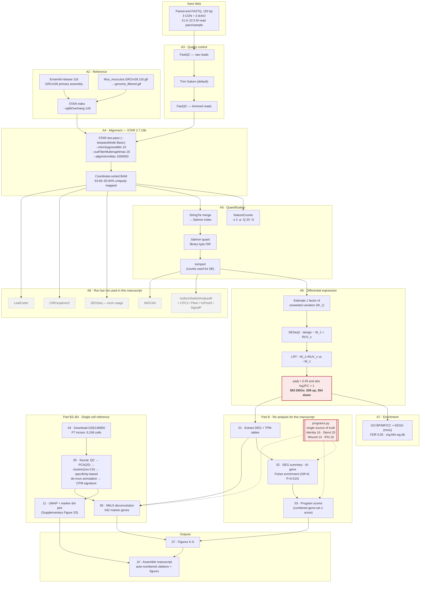

# Supplementary Methods — Complete Bioinformatics Pipeline

*Epithelial Smad4 loss reprograms ameloblast identity and metabolism*

This document records the exact workflow, parameters, and software versions for all
computational analyses, in two parts: **Part A**, the primary bulk RNA-sequencing
pipeline (as executed and recorded in the analysis logs); and **Part B**, the
re-analysis performed for this manuscript (gene-program scoring and cell-type
deconvolution). Values are transcribed from the pipeline's own logs and saved
parameter objects; where a parameter was not recorded, this is stated explicitly
rather than inferred.

---

## Part A — Primary bulk RNA-sequencing pipeline

### A1. Experimental design

| Field | Value |
|---|---|
| Samples | 6: CON1, CON2, CON3 (control) and dcKO1, dcKO2, dcKO3 (Smad4 conditional knockout) |
| Genotype | dcKO: **K14-creER; Smad4^fl/fl^** (tamoxifen-inducible epithelial deletion at the secretory stage). CON: Cre-negative Smad4^fl/fl^ littermates. The constitutive K14-cre line was used for the in vivo enamel phenotype (Figure 1), not for the sequenced material. |
| Groups | 2 groups × 3 biological replicates |
| Tissue | Dental epithelium (mandibular molar tooth germ) |
| Layout | Paired-end, 150 bp |
| Library strandedness | Reverse-stranded; automatically detected by Salmon as **ISR**, and used as `-s 2` in featureCounts |
| Contrast | dcKO vs CON |

### A2. Reference genome and annotation

| Field | Value |
|---|---|
| Assembly | *Mus musculus* GRCm39, `Mus_musculus.GRCm39.dna.primary_assembly.fa` |
| Annotation | `Mus_musculus.GRCm39.116.gtf` |
| Source | Ensembl **release 116** (`ftp://ftp.ensembl.org/pub/release-116/`) |
| Annotation database | `org.Mm.eg.db`; biomaRt dataset `mmusculus_gene_ensembl`; KEGG organism `mmu`; UniProt taxon `10090` |

The GTF was filtered before index building (`genome_filtered.gtf`); genes lacking a
`gene_name` attribute retained their `gene_id`.

### A3. Read quality control and trimming

- **FastQC** on the provider-supplied reads, on trimmed reads, and on aligned BAM files.

> **Processing level of the deposited sequence files.** The sequencing provider (LC-Bio)
> returned adapter- and quality-filtered files, named `*_Clean_Data[12].fastq.gz`. Reads
> prior to that filtering were not returned and cannot be deposited. These files are what
> is deposited in GEO and what Trim Galore took as input, so the deposit represents the
> rawest data available for this study rather than unfiltered instrument output. The
> distinction matters when comparing read counts with studies that deposit unfiltered
> reads.

- **Trim Galore v0.6.10** (wrapping **cutadapt v4.9**) with default settings: quality
  Phred cutoff 20, ASCII+33 encoding, automatic adapter detection.

**Disclosed inconsistency.** Adapter detection is performed per sample, and the
auto-detected adapter was **not identical across samples**: CON1 was trimmed using the
Illumina small-RNA adapter (`TGGAATTCTCGG`), whereas CON2, CON3 and all dcKO samples
were trimmed using the Nextera transposase sequence (`CTGTCTCTTATA`). The detection
counts were very low and near-tied for CON1 (8 versus 6 for the runner-up), indicating
negligible adapter contamination in that library, so the practical effect is expected
to be minimal; we report it for completeness.

### A4. Alignment (STAR)

**STAR version 2.7.10b.**

Index construction:
```
STAR --runThreadN 32 --runMode genomeGenerate \
     --genomeDir ./GenomeIndex_ENSEMBL_STAR_ReadLength149/ \
     --genomeFastaFiles genome.fa --sjdbGTFfile genome_filtered.gtf \
     --sjdbOverhang 149 --limitGenomeGenerateRAM 101781612134
```

Alignment (per sample; two-pass):
```
STAR --runMode alignReads --chimSegmentMin 10 \
     --genomeDir ./GenomeIndex_ENSEMBL_STAR_ReadLength149 \
     --readFilesIn <sample>_Clean_Data1_val_1.fq.gz <sample>_Clean_Data2_val_2.fq.gz \
     --outFileNamePrefix ./<sample>.STAR. --alignEndsType Local \
     --outSAMtype BAM SortedByCoordinate --outFilterMultimapNmax 20 \
     --outFilterMismatchNmax 999 --outFilterMismatchNoverLmax 0.04 \
     --alignIntronMin 70 --alignIntronMax 1000000 --alignMatesGapMax 1000000 \
     --alignSJoverhangMin 8 --alignSJDBoverhangMin 1 \
     --outSAMstrandField intronMotif --outFilterType BySJout \
     --twopassMode Basic --outSAMmapqUnique 60 \
     --limitGenomeGenerateRAM 101781612134 --runThreadN 32 --readFilesCommand zcat
```

**Mapping statistics (from `*.STAR.Log.final.out`):**

| Sample | Input read pairs | Uniquely mapped | Uniquely mapped % | Multi-mapped % | Chimeric % |
|---|---|---|---|---|---|
| CON1 | 21,303,455 | 19,975,969 | 93.77 | 3.85 | 0.30 |
| CON2 | 21,235,660 | 19,900,363 | 93.71 | 3.80 | 0.29 |
| CON3 | 20,986,103 | 19,694,042 | 93.84 | 3.81 | 0.28 |
| dcKO1 | 22,453,825 | 21,044,062 | 93.72 | 3.79 | 0.30 |
| dcKO2 | 21,439,266 | 20,080,247 | 93.66 | 3.74 | 0.31 |
| dcKO3 | 22,455,897 | 21,031,771 | 93.66 | 3.77 | 0.28 |

Mapping was uniform across samples (uniquely mapped 93.66–93.84%), with no
genotype-associated difference in alignment quality.

### A5. Quantification

Two quantifications were produced:

1. **featureCounts** (gene-level counts from the STAR BAMs):
   `featureCounts -T 32 -s 2 -p -Q 20 -O -a ./genome_filtered.gtf -o <sample>.STAR.counts`
   (`-s 2` reverse-stranded; `-p` paired-end; `-Q 20` minimum mapping quality; `-O`
   assign reads overlapping multiple features.)
2. **Salmon v1.10.0** selective alignment (`--libType A`, auto-detected as **ISR** in
   every sample) against an index built from a **StringTie**-merged
   transcriptome (a de-novo assembly merged with the reference annotation); library
   type auto-detected as **ISR**.

**The differential-expression analysis used the Salmon quantifications imported with
tximport** (pipeline parameter `CountsFrom = "Tximport"`). Transcripts per million
(TPM) reported in this study derive from that import.

### A6. Differential expression (DESeq2 with RUV correction)

This is the step most often mis-stated; the parameters below are transcribed from the
saved `DESeqDataSet` and the pipeline parameter object.

| Field | Value |
|---|---|
| Package | DESeq2 |
| Counts | Salmon → tximport |
| Unwanted-variation correction | **RUVSeq**, one factor (k = 1), stored as covariate `W_1`. *The specific RUVSeq function (RUVg/RUVs/RUVr) and the control-gene set are not recorded in the pipeline outputs; k = 1 is recoverable from the single `W_1` column.* |
| Design formula | `~ W_1 + RUV_x` (where `RUV_x` is genotype: CON, dcKO) |
| Test | **Likelihood-ratio test (LRT)**, full `~ W_1 + RUV_x` vs reduced `~ W_1` (`Par_Test = "LRT"`) |
| Contrast | `RUV_x`, dcKO vs CON |
| Expression filter | Genes with at least **10 reads in at least 3 samples** (`Par_ReN = 10`, `Par_SaN = 3`) |
| Genes tested | 15,803 |
| Significance | `padj < 0.05` (Benjamini–Hochberg) **and** `|log2 fold change| > 1` (`Par_FDR = 0.05`, `Par_LFC = 1`, `Par_PorFRR = "padj"`) |
| Log2 fold-change shrinkage | Not applied (fold changes are maximum-likelihood estimates) |
| Independent filtering | Enabled; **613 genes (3.9%) have `padj = NA`** and are treated as non-significant |
| Result | **563 differentially expressed genes: 209 up-regulated, 354 down-regulated** |

Because the LRT compares the full and reduced models, the reported *P* values test the
overall genotype effect after adjusting for `W_1`; the accompanying log2 fold changes
are the maximum-likelihood estimates for `RUV_x dcKO vs CON`.

### A7. Functional enrichment

- Over-representation analysis (ORA) and GSEA against **GO** (biological process,
  molecular function, cellular component) and **KEGG** (organism `mmu`), using the
  `org.Mm.eg.db` annotation package in R.
- **Significance was assessed on the raw *P* value, not the false-discovery rate.** The
  report states that enriched GO and KEGG terms, in both GSEA and ORA, "were defined as
  P-value < 0.05", and the pipeline parameter `Par_UseFDR4FEA = FALSE` confirms that FDR
  filtering was disabled. Enrichment results are therefore **not multiplicity-corrected**
  and are used in this manuscript only as qualitative corroboration of programs that were
  independently identified from the ranked differential-expression results; no enrichment
  statistic is reported as a finding.
- The enrichment software is **not named** anywhere in the pipeline outputs.
  **[[Authors: confirm the enrichment package and version before submission.]]**
- Sample clustering/heatmaps used Pearson distance with **ward.D2** linkage
  (`Par_dist = "pearson"`, `Par_hclust = "ward.D2"`).

### A8. Additional analyses performed by the primary pipeline

These were run but are **not used in the present manuscript**; they are listed for
completeness and transparency.

| Analysis | Tool (version) | Outcome — stated accurately |
|---|---|---|
| Differential exon usage | DEXSeq v1.48.0 | 700 significant exon bins across 331 genes at FDR < 0.1 — **but tested on a restricted subset of 987 genes, not transcriptome-wide**. Not used. |
| Isoform switching | IsoformSwitchAnalyzeR v2.2.0 with CPC2, Pfam, SignalP 6.0, IUPred3 | 1,288 isoform switches in 1,098 genes; **no alternative-splicing type and no functional consequence reached enrichment significance**. Not used. |
| Intron excision | LeafCutter | **Only intron clustering was run; no differential intron-excision test was performed.** LeafCutter must not be cited as a completed differential analysis. |
| Circular RNA | CIRCexplorer2 v2.3.8 + circRNAprofiler | 184 circRNAs detected from 210 back-spliced junctions; **0 differentially expressed**. The RBP-motif module failed (the ATtRACT motif database could not be downloaded) and produced no output. Not used. |
| Co-expression networks | WGCNA | 27 modules. **The soft-thresholding power actually selected, the network type, and the TOM type are not recorded**, so the network cannot be reproduced exactly. With n = 6 and a binary trait, module–trait correlations are point-biserial coefficients on six points and are not interpretable as discoveries. Not used. |

**Statement on excluded analyses.** None of the analyses in the table above is used in
the main text, and each is excluded for a stated reason: the circular-RNA arm returned
no differentially expressed circRNAs; the isoform-switching arm returned switches but no
enriched splicing type or functional consequence; the exon-usage arm was run on a
restricted gene subset; LeafCutter differential testing was never executed; and the
WGCNA network cannot be reproduced because its key parameters were not recorded and is
in any case underpowered at n = 6. An earlier draft of this project additionally
explored a KMT2D/ENCODE epigenetic model; that analysis was discarded because *Kmt2d* is
not differentially expressed in these data (log2 fold change −0.08, adjusted *P* = 0.36).

### A9. Parameters that could not be recovered

For transparency, the following were **not recorded** anywhere in the pipeline outputs
and are therefore not stated in this manuscript. They would be required for a bit-exact
reproduction of the primary pipeline:

- The RUVSeq function used (RUVg, RUVs or RUVr) and its control-gene set.
- The WGCNA soft-thresholding power selected, network type, TOM type and correlation type.
- GSEA parameters (ranking metric, permutation number, minimum and maximum gene-set size)
  and the ORA background/universe set.
- The DEXSeq design formula, in particular whether the RUV covariate was carried into the
  exon-usage model.
- The sequencing library-preparation kit.

A further inconsistency is noted: the gene-level DESeq2 model and the isoform-level
analysis each adjusted for a single latent factor, but these were **different vectors**
(they differ in sign for one sample), so the two analyses did not correct for the same
unwanted variation. This does not affect the gene-level results reported here, which are
the only ones used.

---

## Part B — Re-analysis performed for this manuscript

All code is provided in `scripts/JDR_reanalysis/` and is deterministic (fixed seeds).

### B1. Software versions

| Component | Version |
|---|---|
| Python | 3.10.20 |
| numpy / pandas / scipy / matplotlib | 1.26.4 / 2.3.3 / 1.13.1 / 3.10.9 |
| R | 4.3.2 |
| Seurat / SeuratObject | 5.3.1 / 5.2.0 |
| Matrix / uwot / ggplot2 / patchwork | 1.6.5 / 0.2.3 / 4.0.0 / 1.3.2 |
| Pandoc (document assembly) | 2.9.2.1 |
| Operating system | Ubuntu 22.04.5 LTS (Linux 6.8.0) |

### B2. Gene-program scoring

The four curated programs are defined once in `scripts/JDR_reanalysis/programs.py` and
imported by every analysis and figure script, so that scoring and display always use
identical gene sets. Membership is tabulated below.

**Two membership decisions are recorded explicitly.** (i) *Krt76* is among the most
strongly reduced transcripts in the mutant epithelium (log2 fold change −4.64) but was
**excluded** from the ameloblast-identity program: no published work characterises Krt76
in ameloblasts, and the paper most often associated with hair keratins in enamel concerns
*KRT75*, not *KRT76*. It is therefore reported in the main text as an observation rather
than as a literature-defined program member. (ii) *Mmp12* is retained in the wound/stress
program because it behaves with the rest of that program, but it is classically a
macrophage metalloelastase and may be contributed in part by non-epithelial cells; this
caveat is stated in the main text.

**Program membership.** The four programs follow published definitions and are defined
once in `scripts/JDR_reanalysis/programs.py`:

| Program | *n* | Members | Basis |
|---|---|---|---|
| Ameloblast identity | 16 | *Amelx, Ambn, Enam, Amtn, Mmp20, Klk4, Acp4, Lamc2* (matrix and maturation proteases); *Dlx3, Sp6, Shh, Gli1, Wnt10a, Trp63, Nfic, Sp7* (lineage transcription factors) | Lacruz et al. 2017; Bartlett 2013; Balic and Thesleff 2015; Zhang et al. 2015; Rhodes et al. 2021; Lee et al. 2018 |
| Sterol biosynthesis | 20 | *Hmgcr, Hmgcs1, Mvd, Fdps, Sqle, Msmo1, Idi1, Ldlr, Insig1* (nine experimentally defined direct SREBP targets), *Srebf2*, and *Fdft1, Lss, Cyp51, Dhcr7, Dhcr24, Nsdhl, Mvk, Pmvk, Acat2, Sc5d* | Horton et al. 2003 |
| Wound / stress | 14 | *Mmp10, Mmp12, Mmp13, Ereg, Areg, Ptgs2, Il1a, Cxcl2, Csf3, Fosl1, Mt1, Mt2, Slc7a11, Sprr1a* | Werner and Grose 2003; Ge et al. 2017 |
| Interferon-stimulated | 18 | *Irf7, Irf9, Stat1, Isg15, Mx1, Oasl1, Oas1a, Oas2, Oas3, Ifit1, Ifit2, Ifit3, Ifi44, Ifi27l2a, Rsad2, Usp18, Bst2, Ccl5* | Interferome (Rusinova et al. 2013) |

For each sample, a **program score** was computed as the mean of gene-wise *z*-scores
of log2(TPM + 1) across program members — the combined gene-set *z*-score of Lee et al.
(2008).

**Statistics: exact permutation, not *t* test.** Genotypes were compared by an exact
permutation test over all C(6,3) = 20 label assignments. A parametric *t* test is **not**
valid on these scores: each gene is *z*-scored across the same six samples before
averaging, which forces a coherent program toward ±1 in the two groups and drives
within-group variance toward zero, returning *P* values (10⁻⁶–10⁻⁸) that measure the
arithmetic of the scoring procedure rather than biological replication. With three animals
per genotype, **0.10 is the smallest *P* value the design can produce**, and all four
programs attain it — i.e. the maximum separation the design can express. Program scores are
therefore reported as **effect sizes**; statistical support for individual genes rests on
the gene-level DESeq2 statistics.

| Program | *n* genes | CON | dcKO | Exact permutation *P* |
|---|---|---|---|---|
| Ameloblast identity | 16 | +0.90 | −0.90 | 0.10 (floor) |
| Sterol biosynthesis | 20 | −0.91 | +0.91 | 0.10 (floor) |
| Wound / stress | 14 | −0.91 | +0.91 | 0.10 (floor) |
| Interferon-stimulated | 18 | +0.88 | −0.88 | 0.10 (floor) |

### B3. Single-cell reference and annotation

| Field | Value |
|---|---|
| Dataset | Gene Expression Omnibus **GSE146855** (Chiba et al. 2020), postnatal day 7 mouse incisor, 10x Genomics |
| Cells after quality control | 6,248 (of 6,260 deposited) |
| QC filters | `nFeature_RNA` > 200 and < 7,000; mitochondrial content < 25%; genes detected in ≥ 3 cells |
| Normalisation | `NormalizeData` (log-normalisation, scale factor 10,000) |
| Variable features | 2,000 (`FindVariableFeatures`, vst) |
| Dimensionality reduction | `RunPCA`, 30 components computed; **20 PCs** used downstream |
| Clustering | `FindNeighbors(dims = 1:20)`, `FindClusters(resolution = 0.6)` → 17 clusters |
| Embedding | `RunUMAP(dims = 1:20)` (uwot, cosine metric) |
| Seed | `set.seed(1)` |

**Annotation strategy (important).** Enamel-matrix transcripts (*Amelx*, *Ambn*,
*Enam*) are so abundant in this tissue that they appear as ambient RNA in every
droplet — visible in Supplementary Figure S3B as low-level detection across all cell
types. Assigning clusters by absolute marker expression would therefore label every
cluster an ameloblast. Each cluster was instead assigned to the cell type whose
canonical marker set showed the highest **cross-cluster specificity**, computed as the
mean *z*-score of marker expression across clusters.

Marker sets used: secretory ameloblast (*Amelx, Ambn, Enam, Mmp20*); maturation
ameloblast (*Klk4, Odam, Amtn, Slc24a4*); other dental epithelium (*Shh, Sfrp5, Krt14,
Krt5, Epcam, Thbd, Gjb3, Cldn10*); mesenchyme (*Col1a1, Dcn, Lum, Prrx1, Pdgfra, Msx1,
Sp7, Dspp*); immune (*Ptprc, Lyz2, C1qa, Cd68, Fcer1g*); endothelial (*Pecam1, Cdh5,
Egfl7, Emcn*); erythroid (*Hba-a1, Hbb-bs, Hba-a2*).

**Resulting reference composition** (Supplementary Figure S3):

| Cell type | Cells | % |
|---|---|---|
| Mesenchyme | 2,527 | 40.4 |
| Epithelial (inner enamel epithelium / stratum intermedium) | 1,361 | 21.8 |
| Ameloblast, maturation-stage | 1,346 | 21.5 |
| Ameloblast, secretory-stage | 506 | 8.1 |
| Endothelial | 290 | 4.6 |
| Immune | 131 | 2.1 |
| Erythroid | 87 | 1.4 |

### B4. Cell-type deconvolution

| Field | Value |
|---|---|
| Reference signature | Pseudobulk counts per annotated cell type, converted to counts per million |
| Marker panel | Genes with reference expression > 20 CPM in a cell type **and** > 2-fold above the cross-cell-type mean; up to 120 per cell type; union retained and intersected with the bulk matrix (**542 genes**) |
| Method | Non-negative least squares (`scipy.optimize.nnls`; Lawson–Hanson), solved independently per bulk sample |
| Normalisation | Coefficients scaled to sum to 1 per sample |
| Comparison | Two-tailed *t* test, CON vs dcKO |
| Program localisation | Cell-type specificity of each program = mean across-cell-type *z*-score of reference expression of its member genes |

**Result:** ameloblast maturation-stage 56.9% → 61.3% (*P* = 0.006); secretory-stage
33.7% → 35.1% (*P* = 0.084); mesenchyme 9.4% → 3.6% (*P* = 0.002); other populations
below the detection limit of the fit in this dissected-epithelium material.

**Limitations, stated explicitly.** (i) The reference is postnatal-day-7 **incisor**
whereas the bulk material is molar-stage, so proportions are relative rather than
absolute; the CON-versus-dcKO contrast is the robust readout. (ii) Bulk values are TPM
and reference values are CPM, an acknowledged unit mismatch. (iii) The reference was
annotated de novo rather than using author labels, which are not distributed with the
GEO submission. (iv) A stage-matched molar atlas (for example GSE146123) would refine
the immune and endothelial estimates, on which the interferon interpretation depends.

### B5. Reproducibility

The complete chain regenerates from raw inputs. After an unrelated hardware failure
destroyed the intermediate files, the reference was re-downloaded and re-annotated from
scratch and the deconvolution reproduced identically (56.9% → 61.3%, *P* = 0.006;
9.4% → 3.6%, *P* = 0.002).

### B6. Amelogenesis-imperfecta gene panel, ortholog mapping and enrichment

**Panel source.** Human amelogenesis-imperfecta (AI) genes were taken from the Genomics
England **PanelApp** panel 269, "Amelogenesis imperfecta", **version 4.37** (panel version
dated 24 June 2026; retrieved 27 July 2026 by `17_fetch_ai_panel.py`, which pins the
version and fails loudly rather than falling back to a stored copy). Only genes rated
**GREEN** (high, diagnostic-grade evidence) were used, giving **31 genes**. An external,
versioned, publicly retrievable panel was used in preference to a list curated in-house so
that the exact gene set is reproducible by a reader. The **15 amber- and red-rated genes**
on the same panel were excluded and are named here rather than filtered silently: *AIRE,
ALPL, AMTN, CLDN16, CLDN19, DSPP, ITGB4, KCNJ1, LAMC2, NECTIN4, SMARCD2, SMOC2, TMEM165,
TP63, TUFT1*. Per-gene provenance (OMIM phenotype MIM, inheritance, primary reference,
mouse ortholog) is given in **Supplementary Table S2**; **Supplementary Table S1** records
the verification audit of the superseded hand-curated list.

**Ortholog mapping.** Human genes were mapped to mouse orthologs using the Mouse Genome
Informatics vertebrate homology report (`HOM_MouseHumanSequence`), accepting only
unambiguous one-to-one homology classes. Three genes required explicit manual resolution
for nomenclature reasons, each documented in the analysis code:

| Gene | Resolution | Reason |
|---|---|---|
| *AMELX* | → *Amelx* | its MGI homology class also contains the Y-linked paralog *AMELY*, so the 1:1 filter rejects it |
| *C4orf26* | → *Odaph* | PanelApp retains the retired symbol; HGNC renamed the gene *ODAPH* |
| *FAM83H* | → *Fam83h* | renamed *SACK1H* by HGNC in February 2026, but carried as *Fam83h* in the Ensembl release 116 annotation used here |

Matching was performed on **mouse symbols**. The human-ortholog annotation column of the
differential-expression table was deliberately *not* used: it is empty for **40.9%** of
tested genes, and because `Series.isin()` treats a missing value as a non-match, using it
silently scored seven genuine, strongly down-regulated AI genes as non-risk. The resolution
step therefore raises an error if any panel gene cannot be located, rather than proceeding
on a truncated panel.

**Enrichment and threshold sensitivity.** Over-representation of panel genes among
down- versus up-regulated genes was assessed by a one-sided Fisher exact test. The test
used **adjusted *P* < 0.05 with no fold-change threshold**, because the core enamel genes
that carry the signal have |log2 fold change| ≈ 0.4 and are excluded by the fold-change
cutoff used to define DEGs. The result is threshold-dependent and is reported as such:

| Threshold | Panel down | Non-panel down | Panel up | Non-panel up | Odds ratio | *P* (one-sided) |
|---|---|---|---|---|---|---|
| adjusted *P* < 0.05, no fold-change cutoff | 18 | 2060 | 2 | 2107 | 9.21 | 1.7 × 10⁻⁴ |
| adjusted *P* < 0.05 and \|log2FC\| > 0.25 | 15 | 1778 | 2 | 1656 | 6.99 | 1.9 × 10⁻³ |
| adjusted *P* < 0.05 and \|log2FC\| > 1 (the DEG rule) | 0 | 354 | 1 | 208 | — | 1.00 |

At the |log2 fold change| > 1 cutoff used to define the DEG list, only one panel gene
reaches significance and the test is uninformative. The two significant up-regulated panel
genes are *ODAPH* (C4orf26; log2 fold change +1.94) and *ORAI1* (+0.72).

### B7. The conditional allele, resolved from the aligned reads

Because gene-level counts showed *Smad4* modestly **increased** in the mutant libraries
(log2 fold change +0.32, adjusted *P* = 2.7 × 10⁻³) — the opposite of the naive
expectation for a knockout — the locus was examined directly in the alignments rather
than inferred. Two scripts perform this analysis: `20_smad4_loxp_evidence.py` (evidence
tables) and `21_smad4_loxp_figure.py` (Supplementary Figure S5). Both re-derive every
value from the BAM files at run time and raise rather than proceed if any assertion fails.

**Allele structure.** loxP-containing reads are present in all six libraries, carried in
the *soft-clipped* portion of reads that straddle each insertion point (the loxP core is
not in the reference genome, so it cannot align). Fifteen such reads were recovered by
scanning both orientations of the 34-base loxP core across chr18:73,778,000–73,792,000.
One CON1 read (POS 73,784,710, CIGAR `70S79M`) carries genomic sequence, a linker, the
complete loxP core, a second linker and genomic sequence resuming — fixing that
breakpoint unambiguously. Both breakpoints were confirmed against `genome.fa`.

| Field | Value |
|---|---|
| Floxed exon | chr18:73,782,797–73,782,980 (184 bp), entirely coding |
| Exon identity | exon 9 of ENSMUST00000025393 (canonical); exon 8 in the conventional 11-exon numbering |
| Exon accession | ENSMUSE00000143011 in 19 of the 22 transcripts containing this interval; the same interval is labelled ENSMUSE00001829774 (2 transcripts) and ENSMUSE00001829814 (1). **The unambiguous identifier is the coordinate interval, not the accession or the ordinal.** |
| loxP site A | inserted chr18:73,782,242/73,782,243 (±3 bp; `AAC` microhomology), intron 9/10 |
| loxP site B | inserted chr18:73,784,709/73,784,710 (exact; one read spans both flanks), intron 8/9 |
| Floxed interval | 2,467 bp, containing exactly one exon |
| Protein consequence | residues 318–379, amino-terminal MH2 domain; 184 mod 3 = 1, so excision is frameshifting and introduces a premature termination codon in the following exon |

Note that loxP reads occur in **both** genotypes. This is expected: CON animals are
Cre-negative *Smad4*^fl/fl^ and carry the cassette; only Cre is absent.

**The excision product is not detected.** Excision would splice the flanking exons
directly together, creating a junction (chr18:73,782,125–73,790,265) absent from the
control genome. That junction has **zero** supporting reads in all six libraries, against
121–187 uniquely-mapped reads supporting each flanking junction per library
(percent-spliced-in = 1.000 in every sample). By the rule of three, ≥99.4 % of dcKO
*Smad4* mRNA retains the exon. The result is not an aligner artefact: it reproduces in
STAR's `SJ.out.tab`, by direct parsing of `N` CIGAR operations, and by an
alignment-free *k*-mer search, and an unbiased scan of every junction across
chr18:73,780,000–73,792,000 found no dcKO-specific junction anywhere in the gene.

**Exon-level coverage.** Each exon's share of that sample's total *Smad4* exonic signal
was computed under two normalisations (per-base depth and read count), both reported so
that neither the figure nor the text can select the more favourable one. The floxed exon
carries the lowest ratio in the gene (0.92 depth-fraction, 0.889 read-count) and is the
only exon whose CON and dcKO values separate completely under both. This is a weak,
non-significant indication in the expected direction, not evidence: the effect is
8–11 %, it cannot exceed the exact permutation floor of *P* = 0.10 at three-versus-three,
and exon 6 deviates as far in the opposite direction under the depth normalisation.
Coverage cannot in principle settle this question — if the recombined transcript is
degraded, the surviving mRNA is entirely wild-type and a genuinely deleted allele still
reads near 1.0.

**Predicted fate of the recombined transcript.** The coding consequence of excision was
computed directly from the reference sequence rather than assumed. The floxed exon
contributes 184 nucleotides of coding sequence to the canonical transcript (spanning
residues 318–379 of the 551-residue protein, of which 319–378 are encoded entirely
within it); because 184 is not a multiple of three,
its removal shifts the reading frame from the exon 8 | exon 10 junction onward. In the
reconstructed mutant coding sequence that junction falls mid-codon (after coding
nucleotide 952, within codon 318), and the first in-frame termination codon appears at
**codon 321 — only 8 nucleotides into exon 10**. The predicted product is therefore a
320-residue truncation: residues 1–317 of wild-type SMAD4 followed by three
frameshifted residues (Gly-Cys-Thr) and a stop, removing the entire MH2 domain required
for Smad complex formation.

This places the premature termination codon **299 nucleotides upstream of the final
exon–exon junction**, far beyond the 50–55 nucleotide threshold at which a terminating
ribosome fails to displace the downstream exon-junction complex. The recombined
transcript is therefore a **canonical substrate for nonsense-mediated decay** and would
be expected to be degraded rather than to accumulate. Consistent with this, Ensembl
annotates *Smad4* transcripts lacking this exon with the `nonsense_mediated_decay`
biotype.

**Transcription is not prematurely terminated.** An alternative explanation for the
absent junction — that the recombined allele terminates transcription at the loxP scar,
so the downstream exons are never transcribed — was tested and rejected. Premature
termination predicts progressive depletion of the exons downstream of the deletion, with
the final exon most affected. The observed dcKO/CON coverage ratios instead *recover*
across that interval (exon 10, 0.937; exon 11, 0.991; exon 12, 0.989), and exon 8,
which lies upstream of the deletion and cannot be affected by any downstream terminator,
is lower (0.910) than the final exon. Transcription therefore proceeds through the
entire locus in both genotypes. This is expected on first principles as well: the loxP
cassette is present in the control allele too, so were it a terminator the control
libraries would show the same truncation, and they do not.

**Interpretation and its limit.** Two explanations remain compatible with these
observations and cannot be separated by RNA sequencing: nonsense-mediated decay of the
frameshifted recombined transcript, which the analysis above shows is expected to be
efficient, or incomplete recombination in this short-cultured explant material. We note
that decay alone is not a complete explanation, because degradation of a substantial
recombined pool would be expected to *reduce* total *Smad4* transcript, whereas it is
modestly increased; reconciling efficient recombination with these data would require an
additional, untested assumption of transcriptional compensation at the locus. Under either, the mutant libraries are a mixture of recombined and
non-recombined cells in unknown proportion, so the reported effect sizes are
conservative. Quantifying recombination requires an assay independent of transcript
fate — genomic PCR across the floxed interval, an RT-qPCR amplicon spanning the excision
junction, or SMAD4 immunostaining of the sequenced tissue. Note that the RT-qPCR
amplicon used in this study lies in exon 2 (Supplementary Table S3) and is therefore also
unable to report the deletion.

---

## Part C — Workflow diagram



---

## Supplementary Figure S3

**Supplementary Figure S3. The single-cell reference used for deconvolution.**
**(A)** UMAP embedding of 6,248 quality-controlled cells from GSE146855 (postnatal day
7 mouse incisor), coloured by the de-novo cell-type annotation. **(B)** Dot plot of the
canonical markers used to assign each cell type; dot size indicates the percentage of
cells expressing the gene and colour indicates scaled mean expression. Note that
enamel-matrix transcripts (*Amelx*, *Ambn*, *Enam*, *Mmp20*) are detected at low level
in every cluster, reflecting ambient RNA from this highly secretory tissue — the reason
cell types were assigned by cross-cluster specificity rather than absolute expression.
